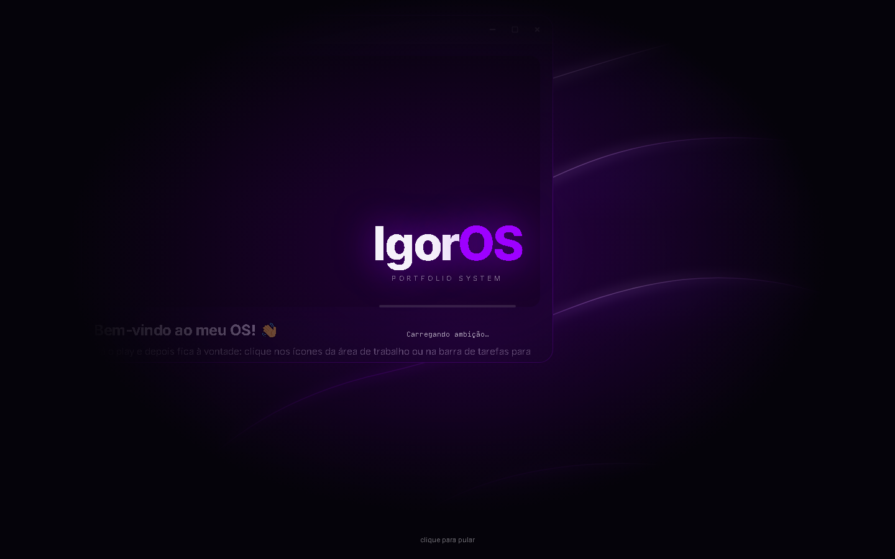
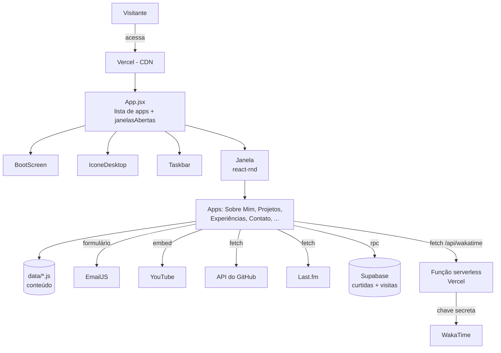
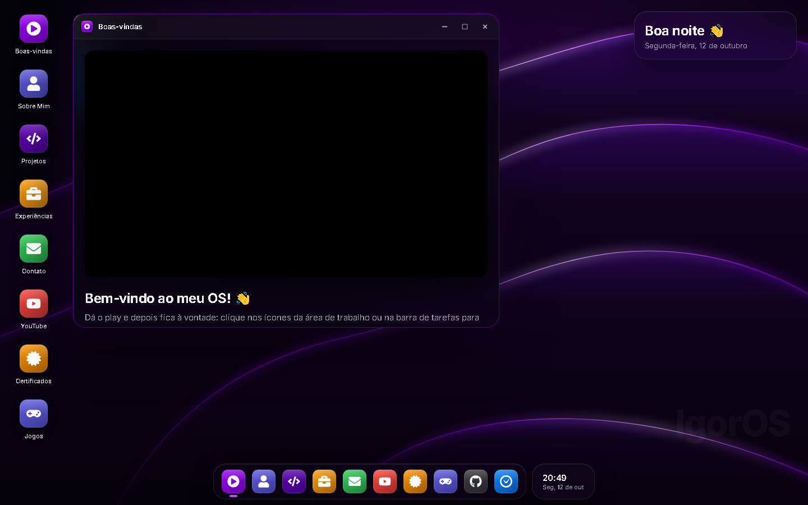
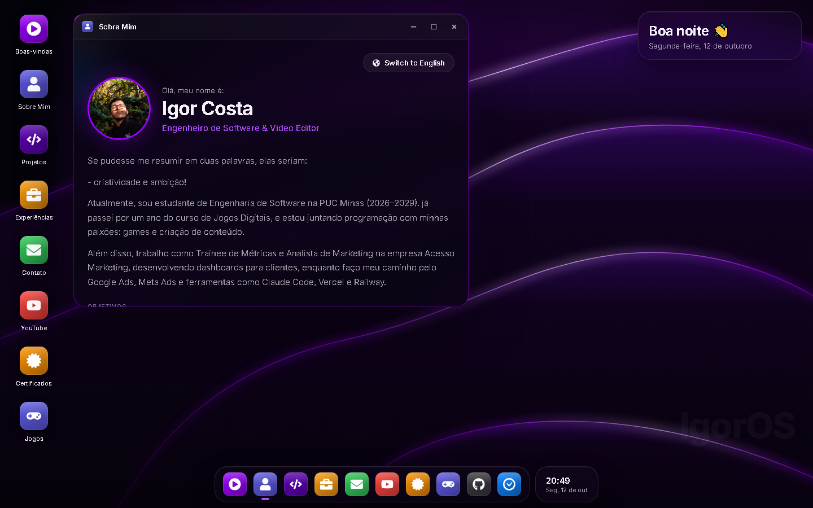
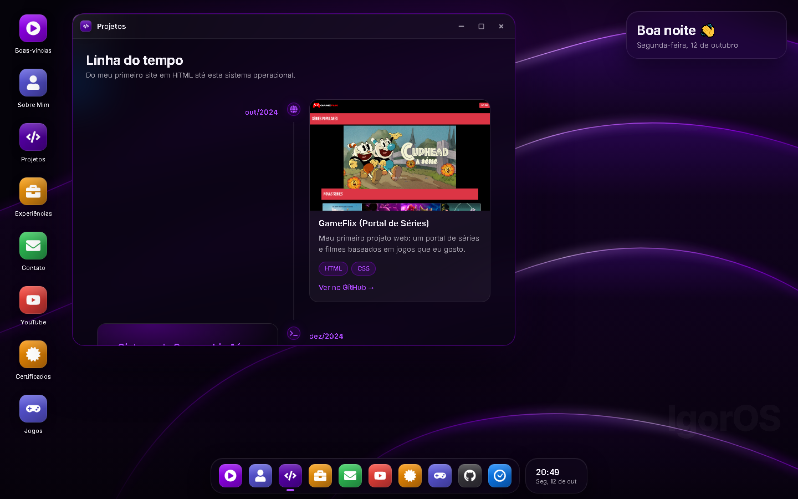
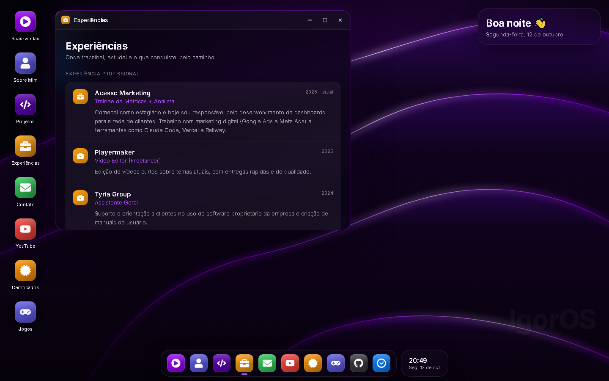
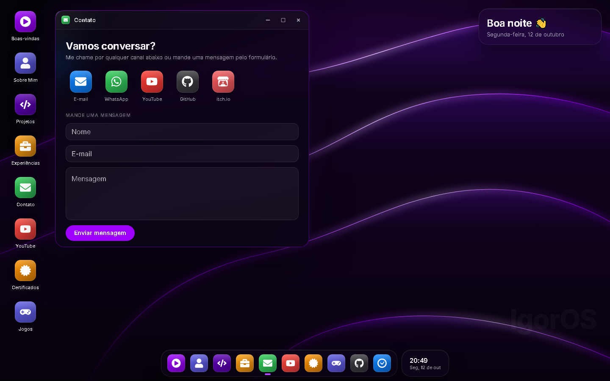
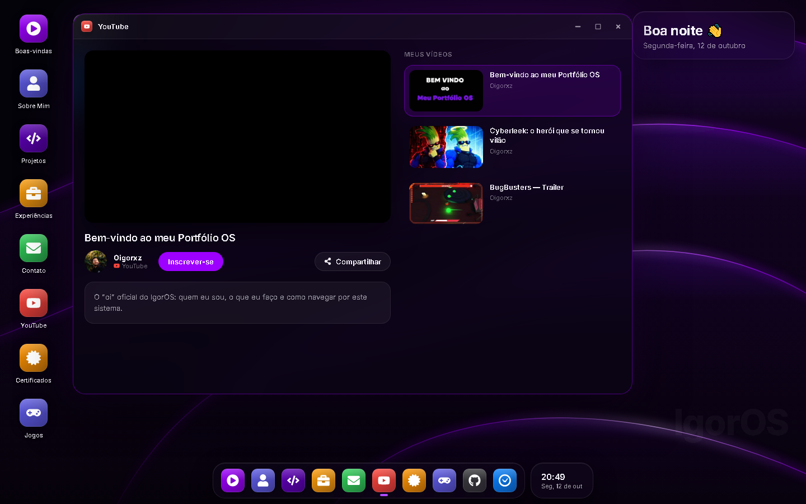
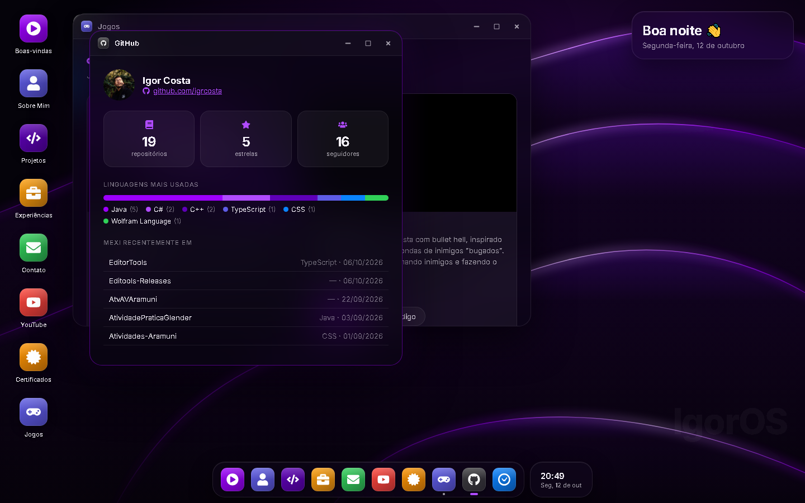
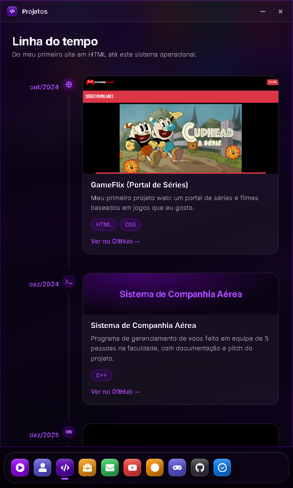

# 🖥️ IgorOS — Portfólio Web OS 👨‍💻

> [!NOTE]
> Um portfólio profissional em formato de **sistema operacional web**: cada seção da minha trajetória é um "app" que abre em janelas arrastáveis, como num desktop de verdade.

<table>
  <tr>
    <td width="800px">
      <div align="justify">
        O <b>IgorOS</b> é o meu portfólio profissional, desenvolvido no <b>Laboratório 01 da disciplina DIAW</b> (Engenharia de Software — PUC Minas). Em vez de um currículo em PDF, o visitante "liga" um computador: passa por uma tela de <i>boot</i>, é recebido por um vídeo de boas-vindas e explora <i>Sobre Mim</i>, <i>Projetos</i>, <i>Experiências</i>, <i>Contato</i> e meus conteúdos em janelas que podem ser <b>arrastadas, redimensionadas e empilhadas</b>. O formato foi escolhido para unir as duas coisas que mais me definem: <b>desenvolvimento de software</b> e <b>criação de conteúdo</b>.
      </div>
    </td>
    <td>
      <div align="center">
        
      </div>
    </td>
  </tr>
</table>

---

## 🚧 Status do Projeto


---

## 📚 Índice
- [Links Úteis](#-links-úteis)
- [Sobre o Projeto](#-sobre-o-projeto)
- [Funcionalidades Principais](#-funcionalidades-principais)
- [Tecnologias Utilizadas](#-tecnologias-utilizadas)
- [Arquitetura](#-arquitetura)
- [Instalação e Execução](#-instalação-e-execução)
- [Deploy](#-deploy)
- [Estrutura de Pastas](#-estrutura-de-pastas)
- [Demonstração](#-demonstração)
- [Testes](#-testes)
- [Documentações utilizadas](#-documentações-utilizadas)
- [Autores](#-autores)
- [Agradecimentos](#-agradecimentos)
- [Licença](#-licença)

---

## 🔗 Links Úteis
* 🌐 **Site no ar:** [igor-portfolio-eight.vercel.app](https://igor-portfolio-eight.vercel.app/)
  > 💻 Hospedado gratuitamente na **Vercel**, com deploy automático a cada `push` na branch `main`.
* 🔗 **Links diretos para apps:** o parâmetro `?abrir=` abre apps específicos ao entrar no site. Ex.: [`?abrir=projetos`](https://igor-portfolio-eight.vercel.app/?abrir=projetos) ou [`?abrir=sobre,contato`](https://igor-portfolio-eight.vercel.app/?abrir=sobre,contato).

---

## 📝 Sobre o Projeto

- **Por que existe:** o laboratório pede um portfólio com Sobre Mim, Projetos, Experiências e Contato. Eu queria que ele também **mostrasse quem eu sou**: alguém que programa, edita vídeos e quer viver de criar conteúdo.
- **Qual problema resolve:** currículos em PDF são estáticos e iguais. Aqui o recrutador ou visitante **explora** a trajetória no próprio ritmo, assiste a vídeos, joga e entra em contato sem sair da página.
- **Contexto:** acadêmico (LAB01 — DIAW, PUC Minas) e profissional. O site é o portfólio que uso no dia a dia, divulgado nas redes e no YouTube.
- **Diferencial:** a interface de sistema operacional (boot, janelas, barra de tarefas) e os links `?abrir=` para divulgação.

---

## ✨ Funcionalidades Principais

- 🖥️ **Desktop com janelas:** janelas arrastáveis e redimensionáveis (`react-rnd`) que podem ser **minimizadas, maximizadas** (botão ou duplo clique) e focadas (a janela clicada vem para a frente). Barra de tarefas no estilo Windows 11 com indicador de apps abertos.
- 🧩 **Widgets na área de trabalho:** relógio, **"tocando agora" no Spotify** (via Last.fm) e **contador de visitas** (Supabase).
- 🚀 **Tela de boot + boas-vindas:** animação de inicialização (exibida uma vez por visita) e janela com vídeo de boas-vindas que abre sozinha.
- 👤 **Sobre Mim bilíngue (PT/EN):** apresentação, objetivos, extras com links e habilidades, com troca de idioma em um clique.
- 🗂️ **Projetos em linha do tempo:** do mais antigo ao mais recente, com descrição, tecnologias, link do GitHub e imagem/trailer, usando o `Timeline` da Material UI.
- 💼 **Experiências:** experiência profissional, formação e conquistas, com empresa/instituição, cargo, período e descrição.
- ✉️ **Contato:** ícones clicáveis (e-mail, WhatsApp, YouTube, GitHub, itch.io) e formulário com **validação** e **envio por e-mail** (EmailJS).
- 📺 **YouTube:** meu canal dentro do OS — player, lista de vídeos, botão de inscrição, **curtidas** (uma por visitante) e **comentários com apelido em tempo real**, tudo salvo no Supabase.
- ⌨️ **WakaTime:** tempo programando nos últimos 7 dias e linguagens mais usadas, buscados por uma **função serverless** (`/api/wakatime`) que protege a chave secreta.
- 🎮 **Jogos:** launcher com os jogos que desenvolvi, com trailer e botão para jogar no navegador (itch.io). Reaproveita os dados da timeline, filtrando `tipo: 'jogo'`.
- 📜 **Certificados:** galeria de certificados com prévia e abertura do PDF.
- 🐙 **GitHub Stats:** repositórios, estrelas, seguidores, linguagens mais usadas e repositórios recentes, buscados em tempo real na **API pública do GitHub** (com cache por sessão).
- 📱 **Responsivo:** em telas menores que 768px as janelas abrem em tela cheia e a barra de tarefas mostra só os ícones.

---

## 🛠 Tecnologias Utilizadas

### 💻 Front-end

* **Biblioteca:** React 19
* **Linguagem:** JavaScript (ES6+), JSX
* **Build Tool:** Vite 8
* **Componentes de UI:** Material UI 9 (`@mui/material`, `@mui/lab` — Timeline, Chip, TextField, Button, Snackbar)
* **Estilização:** design system próprio (`src/theme/`): tokens + componentes base, aplicados via estilos inline; tema da Material UI ligado aos mesmos tokens
* **Tipografia:** Inter e JetBrains Mono (Google Fonts)
* **Janelas:** `react-rnd` (arrastar e redimensionar)
* **Ícones:** `react-icons`
* **Gerenciamento de estado:** `useState` / `useEffect` / `useCallback` do React (estado local, sem bibliotecas externas)

### 🖥️ Serviços (back-end como serviço)

* **Função serverless:** Vercel Functions (Node.js) — `api/wakatime.js`, que guarda a chave secreta do WakaTime no servidor
* **Banco de dados:** Supabase (PostgreSQL) — curtidas e contador de visitas, acessados por funções SQL `security definer` (tabelas protegidas por RLS)
* **E-mail:** EmailJS (`@emailjs/browser`) — envio do formulário de contato direto do front-end
* **Música:** Last.fm API — última música ouvida no Spotify (scrobbles)
* **Código:** WakaTime API — estatísticas de programação
* **Vídeos:** YouTube (embeds)
* **Dados do GitHub:** API REST pública do GitHub (`fetch`, sem token)

### ⚙️ Infraestrutura

* **Cloud / Hospedagem:** Vercel (deploy contínuo a partir do GitHub)
* **Qualidade de código:** ESLint

### 📦 Dependências

| Pacote | Versão | Uso |
| :--- | :--- | :--- |
| `react` / `react-dom` | 19.3 | Biblioteca de interface |
| `react-rnd` | 10.5 | Janelas arrastáveis e redimensionáveis |
| `@mui/material` | 9.5 | Componentes de UI e tema |
| `@mui/lab` | 9.0 (beta) | Componente `Timeline` |
| `@emotion/react` / `@emotion/styled` | 11.14 | Motor de estilos da Material UI |
| `@emailjs/browser` | 5.0 | Envio de e-mail do formulário |
| `react-icons` | 5.7 | Ícones |
| `@supabase/supabase-js` | 2.117 | Cliente do banco de dados (curtidas e visitas) |
| `vite` | 8.3 | Servidor de desenvolvimento e build (dev) |
| `eslint` | 10 | Análise estática de código (dev) |

---

## 🏗 Arquitetura

O projeto é uma **SPA (Single Page Application)** em React, sem rotas: toda a navegação acontece por **janelas**. A arquitetura separa **o sistema operacional** (janelas, ícones, barra de tarefas), **os apps** (cada seção do portfólio) e **os dados** (conteúdo em arquivos `.js`).

- **`App.jsx` — o "kernel":** contém a **lista de apps** (uma única fonte de verdade que gera ícones, botões da barra de tarefas e janelas) e o estado `janelasAbertas`, uma lista de ids em que **a ordem define quem fica na frente** (`zIndex = 10 + posição`).
- **`components/`:** peças reutilizáveis do OS. `Janela` recebe `titulo`, `onClose` e `children` (o app), e decide se renderiza como janela arrastável (PC) ou tela cheia (celular).
- **`apps/`:** cada seção do portfólio é um componente independente.
- **`data/`:** o conteúdo fica separado do código. Para adicionar um projeto, experiência ou certificado, basta editar o arquivo de dados — a interface se atualiza sozinha com `.map()`, `.filter()` e `.sort()`.



### 🎨 Design System

A identidade visual foi construída como um **design system** em [`src/theme/`](meu-portfolio-os/src/theme/), inspirado no macOS/visionOS:

- **Tokens** (`tokens.js`): paleta **preto + roxo `#9D00FF`** com as cores de sistema da Apple, níveis de **vidro** (glassmorphism com `backdrop-filter`), raios, sombras, escala tipográfica (Inter), espaçamentos em múltiplos de 4 e transições. Nenhum componente escreve cor "na mão".
- **Componentes base** (`ui.jsx`): `TelaApp`, `TituloApp`, `TituloSecao`, `Cartao`, `Etiqueta`, `Botao`, `LinkTexto`, reaproveitados por todos os apps.
- **Ícones em ladrilho:** cada app tem um ícone quadrado arredondado com gradiente, como os apps da Apple.
- **Resultado:** de **53 cores diferentes escritas à mão em 183 lugares** para uma única fonte de verdade.

**Decisões e trade-offs:**
- **Estilos inline** deixam cada componente com o próprio visual; o custo é alguma repetição. A **Material UI** foi usada onde ela agrega mais (timeline e formulário com validação).
- **Back-end enxuto:** em vez de um servidor próprio, o projeto usa **serviços gerenciados** (Supabase, EmailJS) e **uma função serverless** só onde há segredo a proteger (WakaTime). Chaves `VITE_*` são públicas por design; a chave do WakaTime fica apenas no servidor.
- **Banco seguro com chave pública:** as tabelas do Supabase têm RLS ativado e nenhuma política de escrita; o site só chama funções SQL específicas (`alternar_curtida`, `registrar_visita`...).
- **Degradação elegante:** cada integração some da tela se não estiver configurada, sem quebrar o site.
- **Datas no formato `AAAA-MM`** permitem ordenar a timeline com uma simples comparação de texto.
- **Sem roteador:** links compartilháveis são feitos com o parâmetro `?abrir=` (lido com `URLSearchParams`).

---

## 🔧 Instalação e Execução

### Pré-requisitos

* **Node.js:** versão LTS (v20 ou superior)
* **Gerenciador de pacotes:** npm

### 🔑 Variáveis de Ambiente

Crie o arquivo **`meu-portfolio-os/.env`** copiando o exemplo (`meu-portfolio-os/.env.example`). Todas são opcionais: sem elas, a funcionalidade correspondente apenas não aparece.

| Variável | Descrição | Onde encontrar |
| :--- | :--- | :--- |
| `VITE_EMAILJS_SERVICE_ID` | ID do serviço de e-mail | EmailJS → Email Services |
| `VITE_EMAILJS_TEMPLATE_ID` | ID do template (usa `{{name}}`, `{{email}}`, `{{message}}`) | EmailJS → Email Templates |
| `VITE_EMAILJS_PUBLIC_KEY` | Chave pública da conta | EmailJS → Account → General |
| `VITE_SUPABASE_URL` | URL do projeto Supabase | Supabase → Project Settings → API |
| `VITE_SUPABASE_PUBLISHABLE_KEY` | Chave pública (publishable / anon) | Supabase → Project Settings → API |
| `VITE_LASTFM_USER` | Usuário do Last.fm | last.fm |
| `VITE_LASTFM_API_KEY` | Chave da API do Last.fm | last.fm/api/account/create |
| `WAKATIME_API_KEY` | Chave **secreta** do WakaTime (sem `VITE_`, lida só pela função serverless) | wakatime.com/settings/api-key |

> **Obs:** em projetos **Vite**, só variáveis com prefixo `VITE_` chegam ao front-end — por isso a chave do WakaTime **não** usa o prefixo.

#### 💾 Banco de dados (Supabase)

No painel do Supabase, abra **SQL Editor → New query**, cole o conteúdo de [`meu-portfolio-os/supabase/schema.sql`](meu-portfolio-os/supabase/schema.sql) e clique em **Run**. O script cria as tabelas `curtidas`, `comentarios` e `visitas` e as funções usadas pelo site (pode ser executado de novo sem problemas).

### 📦 Instalação de Dependências

```bash
git clone https://github.com/igrcosta/Portfolio-PROJECT.git
cd Portfolio-PROJECT/meu-portfolio-os
npm install
```

### ⚡ Como Executar a Aplicação

```bash
npm run dev       # servidor de desenvolvimento
```
🎨 *Disponível em **http://localhost:5173**.*

> 💡 A função serverless (`/api/wakatime`) só roda na Vercel. Para testá-la localmente, use `npx vercel dev` no lugar de `npm run dev`.

Outros scripts:

```bash
npm run build     # gera a versão de produção em /dist
npm run preview   # serve a versão de produção localmente
npm run lint      # verifica o código com o ESLint
```

---

## 🚀 Deploy

O site é hospedado na **Vercel**, conectada a este repositório:

1. **Add New → Project** na Vercel e importar o repositório `Portfolio-PROJECT`.
2. **Root Directory:** `meu-portfolio-os` (o projeto fica nessa subpasta).
3. **Framework Preset:** Vite (detectado automaticamente) — build `npm run build`, saída `dist`.
4. **Environment Variables:** cadastrar as variáveis da tabela acima (EmailJS, Supabase, Last.fm e WakaTime).
5. A cada `git push` na `main`, a Vercel faz um novo deploy automaticamente.

---

## 📂 Estrutura de Pastas

```
.
├── README.md                      # 📘 Esta documentação
├── docs/screenshots/              # 🖼️ Prints usados no README
└── meu-portfolio-os/              # 📁 Aplicação React (Vite)
    ├── .env.example               # 🧩 Variáveis de ambiente necessárias (sem valores)
    ├── api/
    │   └── wakatime.js            # ☁️ Função serverless (Vercel): protege a chave do WakaTime
    ├── supabase/
    │   └── schema.sql             # 💾 Tabelas e funções do banco (curtidas e visitas)
    ├── index.html                 # 📄 HTML base
    ├── package.json               # 📦 Dependências e scripts
    ├── public/                    # 📂 Arquivos estáticos
    │   ├── certificates/          # 📜 PDFs e prévias dos certificados
    │   ├── images&Icons/          # 🖼️ Foto e ícones dos apps
    │   └── projetos/              # 🖼️ Prints dos projetos da timeline
    └── src/
        ├── main.jsx               # 🚪 Ponto de entrada + tema da Material UI
        ├── App.jsx                # 🧠 Lista de apps e controle das janelas
        ├── index.css              # 🎨 Reset global
        ├── components/            # 🧱 Peças do OS: Janela, Taskbar, IconeDesktop, Icone, BootScreen, Widgets
        ├── apps/                  # 🪟 Um componente por app: SobreMim, Projetos, Experiencias, Contato...
        ├── data/                  # 🗃️ Conteúdo: sobre, projetos, experiencias, contato, certificados...
        ├── theme/                 # 🎨 Design system: tokens.js (cores, vidro, raios...) e ui.jsx (componentes base)
        ├── hooks/                 # 🎣 useIsMobile, useCurtidas, useComentarios, useVisitas, useTocandoAgora
        └── lib/                   # 🔌 supabase.js (cliente do banco + id anônimo do visitante)
```

---

## 🎥 Demonstração

### 🌐 Aplicação Web

| Tela | Captura de Tela |
| :---: | :---: |
| **Boot** | **Desktop + Boas-vindas** |
|  |  |
| **Sobre Mim (PT/EN)** | **Projetos (timeline)** |
|  |  |
| **Experiências** | **Contato** |
|  |  |
| **YouTube (meu canal)** | **Jogos + GitHub Stats** |
|  |  |

### 📱 Versão Mobile



---

## 🧪 Testes

O projeto não possui testes automatizados. A qualidade é verificada com:

* **Análise estática:** `npm run lint` (ESLint, regras de React Hooks).
* **Build de produção:** `npm run build` sem erros.
* **Testes manuais:** abrir, focar, arrastar e fechar janelas; troca de idioma; ordenação da timeline; validação e envio do formulário; layout em 375px (DevTools) e no celular.

---

## 🔗 Documentações utilizadas

* 📖 [Documentação oficial do **React**](https://react.dev/reference/react)
* 📖 [Guia de configuração do **Vite**](https://vitejs.dev/config/)
* 📖 [**Material UI** — Timeline](https://mui.com/material-ui/react-timeline/) e [componentes](https://mui.com/material-ui/)
* 📖 [**react-rnd**](https://github.com/bokuweb/react-rnd)
* 📖 [**EmailJS** — SDK para navegador](https://www.emailjs.com/docs/sdk/installation/)
* 📖 [**Supabase** — funções do banco (RPC)](https://supabase.com/docs/reference/javascript/rpc) e [Row Level Security](https://supabase.com/docs/guides/database/postgres/row-level-security)
* 📖 [**Vercel Functions**](https://vercel.com/docs/functions)
* 📖 [**Last.fm API** — user.getRecentTracks](https://www.last.fm/api/show/user.getRecentTracks)
* 📖 [**WakaTime API** — stats](https://wakatime.com/developers#stats)
* 📖 [**GitHub REST API** — users e repos](https://docs.github.com/rest/users/users)
* 📖 [**Vercel** — deploy de projetos Vite](https://vercel.com/docs/frameworks/vite)
* 📖 Repositório de referência: [joaopauloaramuni-portfolio](https://github.com/joaopauloaramuni/joaopauloaramuni-portfolio)

---

## 👥 Autores

| 👤 Nome | 🖼️ Foto | :octocat: GitHub | 📺 YouTube | 📤 Gmail |
|---------|----------|-----------------|-------------|-----------|
| Igor Costa | <div align="center"></div> | <div align="center"><a href="https://github.com/igrcosta"></a></div> | <div align="center"><a href="https://www.youtube.com/@Oigorxz">@Oigorxz</a></div> | <div align="center"><a href="mailto:igorcosta250705@gmail.com"></a></div> |

---

## 🙏 Agradecimentos

* [**Engenharia de Software PUC Minas**](https://www.instagram.com/engsoftwarepucminas/) — pelo apoio institucional e estrutura acadêmica.
* [**Prof. Dr. João Paulo Aramuni**](https://github.com/joaopauloaramuni) — pela proposta do laboratório, pelo template deste README e pelo portfólio de referência.

---

## 📄 Licença

Este projeto é distribuído sob a **[Licença MIT](LICENSE)**.

---
